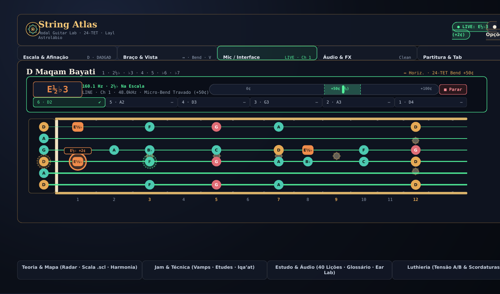
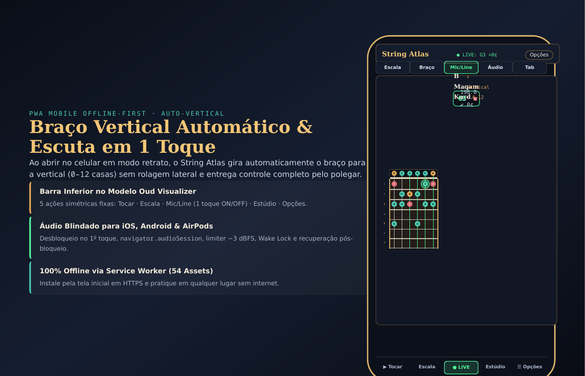
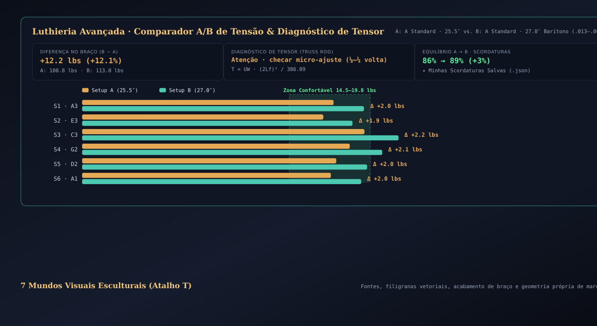

# String Atlas — Modal Guitar Lab

**String Atlas** é um laboratório PWA (*Progressive Web App*) **offline-first** para guitarra elétrica dedicado à experimentação **modal, microtonal (24-TET & Scala `.scl`), harmônica não-tercial, polimétrica, escuta ao vivo via microfone/interface e luthieria física** — construído integralmente em **Vanilla JavaScript (ES Modules), HTML5, CSS3 e Web Audio API**, sem frameworks nem dependências externas.

> 🎸 **Usar o App Online:** [**https://thiago-rss.github.io/string-atlas/**](https://thiago-rss.github.io/string-atlas/)  
> Funciona direto no navegador (desktop e mobile com braço vertical automático) e pode ser instalado na tela inicial para uso 100% offline.
>
> 📖 **Manual Completo em PDF (`v8.6.0`):** consulte [`docs/manual_do_usuario.pdf`](./docs/manual_do_usuario.pdf) ([abrir versão online](https://thiago-rss.github.io/string-atlas/docs/manual_do_usuario.pdf)) para o guia ilustrado dos 5 compartimentos, Mic/Interface ao vivo, Comparador A/B de tensão, Scordaturas Salvas, modos microtonais e atalhos.

---

## Vitrine Visual (`v8.6.0`)

  

| Mobile PWA (Braço Vertical Automático & 1-Toque Mic/Line) | Luthieria Avançada (Comparador A/B de Tensão & 7 Mundos Visuais) |
| :---: | :---: |
|  |  |

---

## Principais Recursos

| Pilar | O que inclui |
| :--- | :--- |
| **Braço Vivo de Luthieria (6, 7 e 8 Cordas)** | **Orientação Dual Automática** (*Horizontal* no desktop · *Vertical* no mobile retrato), vibração física da corda + *ripple*, ressonância de oitavas no *hover*, Zoom `0–12` / `0–22`, Modo Canhoto (`⇄`), Janela Móvel de Formas Fechadas (`4–6` casas), 3 modos microtonais (*Bend +50¢*, *Slide/Fretless*, *Trastes 24-TET*) e **Harmônicos Espectrais** (2º–7º parciais em Entonação Justa). |
| **Microfone & Interface de Áudio (Modelo Oud Visualizer)** | Compartimento **`🎙 Mic / Interface`** no trilho principal + botão 1-toque na barra mobile; detector **YIN (34–1480 Hz)** com modo *Microfone* e *Line Mode* (`L+R · Ch 1 · Ch 2` + hot-plug USB), **HUD Vivo** sobre o braço (Afinador 6/7/8c ↔ Micro-Bend `+50¢`), acompanhamento no braço virtual com cores de escala + **Rastro de Notas** e `mobileAudioGuard.js` (iOS/Android/Bluetooth). |
| **Luthieria Avançada & Scordaturas Salvas** | **Calculadora Física de Tensão** (`T = UW·(2Lf)²/386,09`) com **Comparador A/B lado a lado** (gráfico de barras duplas, `Δ` por corda e **Diagnóstico de Tensor/Truss Rod**), escalas `24″–30″` & *Multi-Scale*, Solver de Calibres Balanceados e **Scordaturas Customizadas Salvas** (6/7/8 cordas em 12/24-TET integradas ao seletor principal, `⌘K` e backups `.json`). |
| **Atlas Expandido & Fronteira Microtonal** | **74 escalas e modos** em 7 domínios (18 *Maqamat*, 7 Modos Gregos, Menor Harmônica/Melódica, Ragas, Japão/Gamelan, Armorial, todos os 7 Modos de Messiaen, Slonimsky e *Pitch-Class Sets*) + **39 afinações** (`E Std` → `B Std`, `A Std`, `7c`, `8c Drop E`, `All Fourths`, `DADGAD`, `CFADGC`) + **Laboratório Scala (`.scl`)** com 12 presets (*Just Intonation 5/7/11-limit*, *53-TET Otomano*, *Bohlen-Pierce 3/1*, *Gamelan real*) e projeção `±¢` no braço. |
| **7 Mundos Visuais Esculturais (`T`)** | *Layl · Astrolábio*, *Nahar · Códice*, *70s Analog · Console Valvulado*, *Doom Ritual · Catedral*, *Djent Poly · Lâmina CNC*, *Avant · Partitura Gráfica* e *Brasilidade · Curvas & Cordel* — cada um com tipografia própria, filigranas vetoriais, acabamento de madeira/carbono e geometria própria de marcadores no braço. |
| **Estúdio em Compartimentos Puros** | **Radar Modal 24-TET**, **Vamps & Sayr**, **Etudes Procedurais (6 geradores)**, **Harmonia Não-Tercial & Construtor de Pitch-Class Set**, **Motor Rítmico Universal (*Iqa’at* & Polimetria)**, **Treino Auditivo 24-TET** e **Dossiê / Lab Oblíquo**. |
| **Currículo Progressivo & Glossário** | **4 Níveis · 9 Capítulos · 40 Lições & 40 Dossiês PT/EN** (de fundamentos em *E Standard/12-TET* até *53-TET/Scala/Pós-Tonal*) integrados ao **Glossário Técnico Interativo (39 termos)** com exemplos sonoros Web Audio. |
| **Exportação Completa** | **Pranchas Didáticas PNG (2× Retina) & SVG**, **MIDI 24-TET (`.mid` com RPN ±2st + Pitch Bend `+50¢` e canais por voz)**, **MusicXML 4.0 (`.musicxml` com tablatura 6/7/8 cordas)**, **Scala `.scl`**, **Tablatura ASCII (`.txt`)**, **Snapshots `#sa=...`** e **Backup `.json`**. |

---

## Instalação como Aplicativo (PWA Offline)

Acesse [**https://thiago-rss.github.io/string-atlas/**](https://thiago-rss.github.io/string-atlas/) em qualquer dispositivo:

- **iOS (Safari):** abra o link → toque em **Compartilhar** → **Adicionar à Tela de Início**.
- **Android (Chrome/Edge):** toque no aviso de instalação ou abra **Opções → ⬇ Instalar App**.
- **macOS (Safari / Chrome):** *Arquivo → Adicionar ao Dock* (Safari) ou ícone de instalação na barra de endereços (Chrome).

---

## Execução Local & Validação

Requer apenas **Node.js 18+** (para validação) e qualquer servidor HTTP estático (Python 3, `npx serve`, etc.):

~~~bash
# 1. Validar integridade, sintaxe, catálogo, DSP YIN, Scala, Tensão A/B, Scordaturas, Glossário e SW
node scripts/check.mjs

# 2. Subir servidor local (libera getUserMedia/Line Mode em localhost)
python3 -m http.server 8080
~~~

Abra `http://localhost:8080` no navegador.

---

## Atalhos de Teclado

| Tecla | Ação |
| :--- | :--- |
| `⌘K` / `Ctrl+K` / `/` | Abrir **Paleta de Comandos** (escalas, afinações salvas, designs, aulas e glossário) |
| `?` | Abrir guia rápido de atalhos |
| `Esc` | Fechar modal / **Parar Todo Áudio** (Panic) |
| `Espaço` / `L` | Tocar/Parar escala ativa · Ligar/Parar **Mic / Interface ao Vivo** |
| `M` | Iniciar / Parar **Vamp & Sayr** |
| `E` / `N` | Tocar / Parar **Etude Procedural** · Nova variação (*Seed*) |
| `D` / `R` | Alternar **Drone** · **Ritmo (Iqa’at & Polimetria)** |
| `V` / `H` | Alternar **Voicing no Braço** · **Harmônicos Espectrais** |
| `T` / `Z` | Alternar **Design Visual (7 Mundos)** · **Modo Zen** |

---

## Arquitetura do Repositório

~~~text
string-atlas/
├── .github/workflows/deploy.yml   # CI (check.mjs) + Deploy GitHub Pages
├── docs/
│   ├── manual_do_usuario.pdf      # Manual ilustrado do usuário v8.6.0 (PDF)
│   ├── preview-desktop-layl.png   # Vitrine Desktop (Layl + Live HUD + 24-TET)
│   ├── preview-mobile-vertical.png# Vitrine Mobile (Braço Vertical Automático)
│   └── preview-luthier-worlds.png # Vitrine Luthieria A/B & 7 Mundos Visuais
├── index.html                     # Shell PWA minimalista em compartimentos
├── manifest.json                  # Manifesto PWA isolado para subpath
├── sw.js                          # Service Worker offline-first (54 assets)
├── assets/icons/                  # Ícones SVG + PNG (192, 512, Apple 180)
├── styles/                        # main.css, themes.css (7 mundos) & mobile.css
├── js/
│   ├── main.js                    # Bootstrap, compartimentos e watcher responsivo
│   ├── state/store.js             # Store reativo unidirecional + localStorage
│   ├── core/                      # Motores puros (24-TET, Scala, Voicing, Etude, Radar, Tensão A/B, Scordaturas, Export, Glossário, Guia)
│   ├── audio/                     # Web Audio (Synth/FX, Rhythm, YIN Pitch, MobileAudioGuard)
│   └── views/                     # Views desacopladas por compartimento (incl. Live Stage HUD)
├── scripts/check.mjs              # Validador de integridade e testes unitários
├── CHANGELOG.md                   # Histórico completo v1.0.0 → v8.6.0
└── LICENSE                        # Licença MIT
~~~

---

## Publicação Automática no GitHub Pages (CI/CD)

Este repositório utiliza o workflow `.github/workflows/deploy.yml`: a cada `push` na branch `main`, o GitHub Actions executa automaticamente `node scripts/check.mjs` e, se todos os testes passarem, publica o bundle estático atualizado em [**https://thiago-rss.github.io/string-atlas/**](https://thiago-rss.github.io/string-atlas/).

---

## Licença

Distribuído sob a licença **MIT**. Consulte o arquivo [`LICENSE`](./LICENSE) para detalhes.
